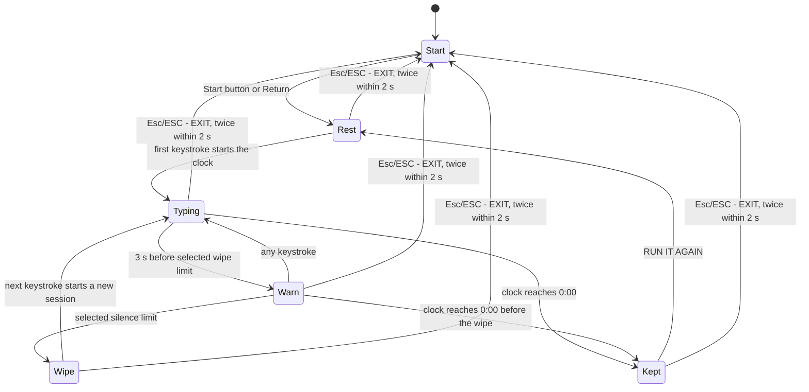
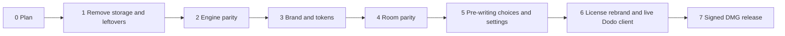

# writeitdown for macOS - Build Plan

Written 2026-09-24. Current candidate provenance and acceptance exceptions are recorded in `MANUAL_QA.md`, under "Final release binding". The inventory and native-source comparisons below record the pre-batch-1 baseline; the last column assigns each change to its batch.

This plan turns the existing native app in `apps/macos/FirstLine/` into the writeitdown macOS app. It is the governing document for every later batch. Each batch lands as one pull request through no-mistakes, merges only when its acceptance is green, and is then accepted again by a fresh session against this document.

## 1. Goal

- The app is a native AppKit writing room that follows the live site's forward-only writing and keeps the draft for copying when the clock runs out. Native silence timing follows the pre-writing choice in section 4, not the site's fixed five/eight-second timing.
- Before writing, the writer chooses a session length and a silence limit. The last chosen length is the default; the standard eight-second limit is the default.
- The desktop app is a small tool, not a landing page: opening it puts the cursor in the writing flow, then the writer copies the text when done and closes it. No screen needs a promotional slogan.
- The app does only the writeitdown thing. First Line and Zero Draft leftovers that do not serve that job (the draft Library, saved Markdown files, Copy for AI, fossils, the separate Failure screen) are removed.
- The paid license flow stays. It is rebranded to writeitdown and reuses the design in `apps/macos/FirstLine/docs/LICENSE_PAYMENT_SPEC.md`.
- Writing never leaves the machine and is never written to disk.

The existing app is already pure AppKit: every source file under `apps/macos/FirstLine/Sources/FirstLine/` imports AppKit or Foundation, and none imports SwiftUI. The work adapts this code. It is not a rewrite from zero.

## 2. Evidence

### 2.1 Baseline of the existing app

- On 2026-09-24, from `apps/macos/FirstLine/`, `swift build` exited 0 and `swift test` exited 0 with 100 tests in 8 suites.
- The tests use Swift Testing (`@Test` functions inside `struct` suites), not XCTest classes. Every test named in this plan is a Swift Testing function and can be run alone with `swift test --filter <Suite>/<function>`.

### 2.2 The live writeitdown.app site

Observed on 2026-09-24 with a Playwright script against https://writeitdown.app in headless Chrome at 1440x900, light appearance. The full log is `/Users/ichts/firstmate-homes/first-line/data/zd-wid-mac-plan/wid-live-2026-09-24.log` and the screenshots are `/Users/ichts/firstmate-homes/first-line/data/zd-wid-mac-plan/shots/wid-*.png`. The live behavior matched the source in `writeitdown/`.

- The CTA `Give it sixty seconds.` opens the `#trial` room and focuses the editor. The empty writing line holds only the caret; the bottom-right count slot reads `Type to start` until the first keystroke. The clock reads `1:00`.
- The clock does not start on entry. After two idle seconds it still read `1:00`; it started on the first keystroke (`writeitdown/session.mjs`, `append`).
- Backspace, Delete, ArrowLeft, ArrowUp, Home, Cmd+Z, Cmd+X, and Cmd+V all left the text unchanged, kept the caret at the end, and announced `BLOCKED. FORWARD ONLY.` in the live region. Cmd+A moved the selection, but the next typed characters still appended at the end.
- Each blocked key ran two 280 ms animations on the paper: a horizontal shake of at most 2 px and a 1 px outline in the `--alarm` color (`writeitdown/feedback.js`). A repeated block does not restart a running shake. A 110 Hz tone plays only after a prior user gesture.
- After 5.3 s of silence the phase was `warn`, the numeral read `3`, and the line `KEEP TYPING OR THE DRAFT IS DELETED.` appeared (screenshot `wid-07-warn.png`). One keystroke returned the phase to `typing` and kept the text.
- After 8.3 s of silence the editor was empty and the report read `DRAFT WIPED - 0:45 UNUSED. TYPE TO RESTART.` The room stayed open and the next keystroke started a fresh minute.
- A full real-time minute with a keystroke every two seconds ended in the kept state: `You wrote it down.`, the full text, the receipt `0:00 - 30 WORDS KEPT.`, focus on `COPY TEXT`, and a `RUN IT AGAIN` link (screenshot `wid-09-kept.png`). Clicking COPY TEXT put the exact draft on the clipboard and the button read `COPIED`.
- Escape left the room, cleared the hash, and returned focus to the CTA.
- Every request was a GET to `writeitdown.app`, `fonts.googleapis.com`, or `fonts.gstatic.com`. No writing was sent anywhere.

### 2.3 The Most Dangerous Writing App (reference for the picker)

Observed on 2026-09-24 at https://www.squibler.io/dangerous-writing-prompt-app, the official URL named by Squibler (which acquired the app in 2019) and by the app's Wikipedia entry. The legacy domain `themostdangerouswritingapp.com` failed with a certificate error on that date. Screenshots are in `/Users/ichts/firstmate-homes/first-line/data/zd-wid-mac-plan/shots/`:

- `mdwa-squibler-02-picker-open.png` shows the open picker.
- `mdwa-squibler-03-words.png` shows the Words tab.
- `mdwa-squibler-06-timed-writing.png` shows the writing screen.
- `mdwa-squibler-05-success.png` shows the success screen.
- `mdwa-squibler-08-failed.png` shows the failure screen.

What the reference does:

- The start screen shows `Session length: 5 minutes` as a small inline control next to the two start buttons (`Generate a prompt` and `Start writing without a prompt`). Clicking it opens a small popover.
- The popover has two tabs, `Minutes / Words`. Minutes offers 3, 5, 10, 15, 20, 30, and 60, with 5 selected by default. Words offers 150, 250, 500, 750, and 1667, with 250 selected by default. A `Hardcore mode` checkbox hides the text and disables backspace. A close button dismisses the popover.
- The choices are plain `span` elements. Tab moves focus to the close button, not to the numbers, so the choices are not reachable from the keyboard.
- The writing screen is a blank page with a word count at the bottom and a thin progress bar along the top edge. It shows no numeric clock. Outside Hardcore mode, backspace works.
- After about five seconds of silence the screen turns red with `You failed...` and a `Try again!` button, and the draft is gone.
- On success the progress bar turns green, the full text stays on screen, and the page offers `Download N words` and `Start Again`.

The reference above is historical evidence, not the native picker specification. The captain superseded its duration set and popover with the duration/silence segments and Begin in section 4. Word-count goals, Hardcore mode, prompts, and the red failure screen remain out of scope.

## 3. Product rules: web to native

The web column cites the file that owns each rule today. The native column records the pre-batch-1 implementation in `apps/macos/FirstLine/Sources/FirstLine/` (shortened to `Sources/` below). The last column assigns each change to its batch.

| # | Rule | Web source | Native baseline (batch 0) | Change |
|---|---|---|---|---|
| 1 | The clock starts on the first input, not on entry. | `writeitdown/session.mjs` (`append`) | `Sources/Session/SessionEngine.swift` starts the clock in `start(duration:)`. An untouched draft is exempt from danger. | Batch 2 starts the clock on the first committed or marked text. |
| 2 | Only appending is allowed. Deletion, cut, paste, drop, undo, redo, arrow keys, Home, and Page Up or Down are blocked. IME composition still works. | `writeitdown/room.js` (`beforeinput`, `keydown`, paste/cut/drop listeners) | `Sources/Editor/AppendOnlyInputPolicy.swift` and `Sources/Editor/AppendOnlyTextView.swift`. Arrow and Home moves are caught by the selection redirect in `Sources/Session/SessionViewController.swift`. | Keep. Batch 2 adds explicit tests for the movement commands. |
| 3 | A blocked action shakes the paper by 2 px, shows a 1 px alarm outline for 280 ms, announces `BLOCKED. FORWARD ONLY.`, and does not restart while running. Reduced motion keeps the outline and drops the shake. | `writeitdown/feedback.js`, `writeitdown/room.js` (`deny`) | `Sources/Session/SessionViewController.swift` (`triggerDenyFeedback`): a 90 ms red hairline, a 160 ms shake, and the narrator line `NO GOING BACK.` | Batch 4 matches the web timing, color, announcement, and no-restart rule. |
| 4 | On the web, after 5 s of silence the wash ramps in, and the numeral counts 3, 2, 1 in the alarm color over `KEEP TYPING OR THE DRAFT IS DELETED.` | `writeitdown/room.js` (`render`), `writeitdown/site.css` | `Sources/Session/SessionEngine.swift` (`dangerAfterSeconds = 5`), with the veil and countdown in `SessionViewController.swift`. | Batch 4 restyles the web timing and numeral. Batch 5 makes the warning start three seconds before the selected wipe limit. |
| 5 | After 8 s of silence the draft is wiped. The room stays open with the deletion report defined in section 4.3 and the next keystroke starts a new session. | `writeitdown/session.mjs` (`advance`), `writeitdown/room.js` | `SessionEngine.swift` (`wipeAfterSeconds = 8`) routes to a separate screen in `Sources/Session/FailureViewController.swift` with fossils. | Batch 2 captures unused time and provides a minimal in-room wipe/restart route. Batch 4 removes the obsolete Failure screen and polishes the report. Batch 5 offers fixed 5/8/12-second wipe limits. |
| 6 | The earlier deadline wins, and a tie goes to the wipe. | `writeitdown/session.mjs` | `SessionEngine.swift` (`adjudicateDeadlines`) | Keep. |
| 7 | A whitespace-only draft at the deadline is wiped, not kept. | `writeitdown/session.mjs` (`!state.text.trim()`) | `SessionEngine.swift` ends an empty draft as idle and keeps a whitespace-only draft. | Batch 2 adopts the web rule. |
| 8 | When the clock runs out, the native kept view shows the live heading `You wrote it down.`, the quiet receipt `N MINUTES. N WORDS.` (real duration and count, no `KEPT`), `COPY TEXT` (then `COPIED`) and `RUN IT AGAIN` above a scrollable draft. Focus goes to COPY TEXT. | `writeitdown/index.html` (`#kept`), `writeitdown/room.js` | Before batch 1, `Sources/Session/SuccessViewController.swift` offered Copy full text, Copy for AI, Download .md, and Discard, and `Sources/App/AppState.swift` autosaved the draft to disk. | Batch 1 removed autosave, Copy for AI, and Download. The current kept presentation is defined in section 6. |
| 9 | The count is Unicode words, and each Han character counts as one. Punctuation and emoji do not count. | `writeitdown/session.mjs` (`wordCount`) | `SessionEngine.swift` (`wordCount`) splits on whitespace only. | Batch 2 ports the web rule. |
| 10 | ESC and the `ESC - EXIT` control leave the room right away. Nothing is saved. | `writeitdown/room.js` (`exit`) | The native room keeps `ESC - EXIT` in every phase and requires a second Esc/click within two seconds, with an inline hint, because the captain asked for accident protection. | Batch 4 added the bottom-left control; the current room adds the two-step confirmation as a deliberate native override of the live immediate exit. |
| 11 | There is no early finish. A session ends only at the deadline or by exiting. | `writeitdown/room.js` | `SessionViewController.swift` has a `Finish` button and Cmd+Return. `SessionEngine.swift` has `finish()`. | Batch 2 removes the engine method, button, Cmd+Return paths, and tests together. |
| 12 | The clock shows `M:SS` at the top right, and the count shows `N words` at the bottom right. | `writeitdown/index.html`, `writeitdown/site.css` | `SessionViewController.swift` shows `MM:SS`, a progress bar, and lowercase `N words`. | Batch 4. |
| 13 | Appearance follows the system by default and can be switched between light and dark. | `writeitdown/theme.js`, `writeitdown/site.css` | `Sources/Infrastructure/SettingsStore.swift` (`AppTheme`), `Sources/DesignSystem/Colors.swift` (the Zero Draft bone palette with red `#c8392f`). | Batch 3 ports the site tokens for both appearances. |
| 14 | No draft is stored. Only the appearance preference persists. | `writeitdown/theme.js` (`writeitdown-theme` is the only key) | Before batch 1, `Sources/Infrastructure/PersistenceService.swift` wrote kept drafts as Markdown and `Sources/Library/LibraryViewController.swift` browsed them. | Batch 1 deleted both. Settings keep only preferences and the license cache (section 7). |
| 15 | The writing view shows the active line in an upper writing band with two fading lines above it and no scrollbar. | `writeitdown/site.css` (`#editor` mask), `writeitdown/room.js` (`fitEditor`) | `SessionViewController.swift` places the current line at 35% of the sheet above the vertical middle; `AppendOnlyTextView.swift` keeps that anchor and applies one uniform opacity per completed line (100/22/7, older hidden). | The sheet midpoint is not the anchor; the live 22%/7% intent is per-line opacity, not a gradient through a line. |
| 16 | The session length and silence limit are chosen before writing. | Fixed at 60 s and 8 s on the web | Fixed at 60 s and 8 s. `AppState.selectedDuration` and `AppSettings.defaultDuration` already exist but are pinned to 60. | Batch 5 adds the duration/silence segments and one Begin action. |

The native start screen needs only the duration and silence choices plus one Begin action; selecting a duration remembers it, and Begin starts it. The native kept presentation follows section 6. The site headline, deck, and `Give it sixty seconds.` style slogans belong to the site, not the app.

The session flow after batch 5, using the web's phase names:



Every room phase keeps one exit control and one Escape path. The first request shows the inline hint `Press Esc again to leave and delete the draft.`; a second request within about two seconds leaves without saving, typing dismisses the hint, and nothing exits on one request.

`Start` is the cursor-ready pre-writing screen with duration/silence segments and Begin. It replaces the Home screen in `Sources/App/HomeViewController.swift`.

## 4. Pre-writing choices and settings

### 4.1 Duration and silence limits

- The duration choices are exactly 1, 5, 10, 20, and 30 minutes. The last chosen duration is remembered in `settings.json` through `AppSettings.defaultDuration`; on first launch it is one minute.
- The silence limits are exactly 5 seconds (Strict), 8 seconds (Standard), and 12 seconds (Relaxed). Standard is the default. These are fixed choices, not free-form input.
- The warning starts during the final three seconds before the wipe: after 2, 5, or 9 seconds of silence respectively. Its 3-2-1 numeral disappears immediately when typing resumes; the wash fades to zero over 120 ms linear, or immediately with reduced motion, matching the live trial. Warn and wipe-cut updates remain immediate.
- The chosen limit governs the wipe deadline; the earlier session or wipe deadline still wins and a tie still wipes. A wipe restarts with the same duration and silence limit.
- The captain's chosen settings replace the earlier recommendation to keep a fixed 5-second warning and 8-second wipe for every duration. Neither threshold scales with session length.

### 4.2 Start screen

- The native start screen has no site headline, deck, or `Give it sixty seconds.` slogan. It shows the After card with one row of five duration segments, the three silence choices, and one Begin action; selecting a duration remembers it, and Begin starts writing immediately with the cursor ready.
- On opening the tool, Begin has keyboard focus. A keyboard-only writer can start the selected duration without a mouse. Duration and silence choices are available on the start screen, not in Settings or the writing room; the clock starts on the first input after entering the room.
- The three silence choices are available before writing, with Standard selected by default. Keep them compact and visibly labeled; do not add a second promotional start action.
- Before the first keystroke, the room clock shows the chosen duration. The clock starts with the first committed or marked text. After a kept session, `RUN IT AGAIN` uses the current choices, subject to the trial/license gate. Escape asks for confirmation first; after the last trial the next session opens activation.
- The old MDWA-style picker, eight-choice duration menu, and Cmd+1 through Cmd+8 length shortcuts are superseded. The Navigate menu offers New Piece, Writing, and Home; Settings remains in the app menu. There is no resident menu-bar utility.

### 4.3 Settings and keyboard

- Settings (`Cmd+,`) offers Focus Mode, alignment, font size, and appearance alongside the existing license and motion controls. Focus Mode is off by default; when on, the room fills the screen and hides the clock and word count until the pointer hovers over their chrome. Deadline announcements remain accessible without hover.
- The paper fills the window (D-004): the live trial's 32 pt margin, 16 pt radius and sheet shadow, at every size including full screen; the fixed 720/880 sheet is retired. The Alignment control chooses the centred writing-column measure: Narrow column (62ch) by default or Wide column (70ch); the persisted `centered` and `left` values remain compatible with existing settings. The current line sits at 35% of the sheet, a little above the vertical middle; earlier lines step through uniform opacities (100/22/7, older hidden) and shift exactly one pitch when a new line begins. After a wipe the clock returns to the chosen duration and the report uses the session's unused time in the live uppercase sentence (`DRAFT DELETED AT M:SS. TYPE TO START AGAIN.`); after the last free trial it instead ends `ACTIVATE TO KEEP WRITING.`. The red receipt carries the instruction and no additional hint is added; the count slot shows the word count. Font size offers Small, Medium, and Large, with Medium as the default. Appearance follows the system by default, with the existing Light and Dark choices.
- Settings preferences may persist without storing draft text. Settings may be viewed while writing and Done returns to the surface from which Settings opened. Duration and silence limits are selected only on the start screen and cannot change while writing; changing focus, alignment, font size, or appearance must not reset the session clock or draft. Native fullscreen exit turns focus mode off during writing; a programmatic exit for Settings navigation preserves the preference, including a quick Settings/Done round trip.
- `Cmd+N` starts a new piece through the existing trial-or-signed-license gate, dropping any current unkept draft without saving it. On the kept view, `Cmd+C` copies the entire draft rather than a partial selection; `Cmd+W` closes the window. The full flow must work without a mouse.
- Word-count goals and a resident menu-bar app are out of scope.

### 4.4 Governance note

`VISION.md` distinguishes the web's fixed sixty seconds from the native duration and silence choices. The captain's current choices replace the previous reference-based options and fixed-threshold recommendation; historical batch 1-4 requirements below record what shipped, not the final native settings.

## 5. Inventory

Paths are relative to `apps/macos/FirstLine/`.

### 5.1 Delete

| Path | Why | Batch |
|---|---|---|
| `Sources/FirstLine/Library/LibraryViewController.swift` | The app keeps no drafts. | 1 |
| `Sources/FirstLine/Infrastructure/PersistenceService.swift` | It writes kept drafts to disk. | 1 |
| `Tests/FirstLineTests/LibraryPersistenceTests.swift` | It tests the deleted Library. | 1 |
| `Tests/FirstLineTests/PersistenceOnlyTests.swift` | It tests the deleted draft storage. | 1 |
| `Sources/FirstLine/Session/SuccessText.swift` | It holds Copy for AI and Markdown export, which the web does not have. `VISION.md` also says there is no AI. | 1 |
| `Tests/FirstLineTests/SuccessSurfaceTests.swift` | It tests `SuccessText`. It is replaced by `KeptSurfaceTests`. | 1 |
| `Sources/FirstLine/Session/FailureViewController.swift` | The wipe report moves into the room. | 4 |
| `Sources/FirstLine/DesignSystem/FossilLayerView.swift` | The site has no fossils. | 4 |

The following code inside kept files is also deleted:

- In `Sources/FirstLine/App/AppState.swift`: batch 1 removes the library state, save retries, Library and delete actions, `revealLibraryFolder`, `.library`, and `updateImmersiveMode`. Batch 4 removes the in-memory `lastWipeFossil` aftermath and `.failure` surface. Batch 6 rebrands `openLaunchWebsite` and license help; neither license nor checkout entry points are removed in batch 1.
- In `Sources/FirstLine/Infrastructure/AppPaths.swift`: `libraryDirectory` and `recoveryDirectory`.
- In `Sources/FirstLine/Infrastructure/SettingsStore.swift`: `immersiveSessionMode` and the writable `hasUnlockedFullAccess` mirror. The no-key licensing fix supersedes the original read-only unlock migration: ignore the legacy flag and require a nonblank license key for active access, as specified in `LICENSE_PAYMENT_SPEC.md`. Batch 3's new brand directory does not import the old configuration directory.
- In `Sources/FirstLine/Session/SessionEngine.swift`: `finish()`.
- In `Sources/FirstLine/Session/SessionViewController.swift`: the fossils, the narrator strip, the Finish button, the Cmd+Return monitor, the progress bar, and the Abandon button.
- In `Sources/FirstLine/App/HomeViewController.swift`: the wipe aftermath line and fossil.
- In `Sources/FirstLine/Settings/SettingsViewController.swift`: the Storage section.
- In `Sources/FirstLine/App/MainMenuBuilder.swift`: the Library item.
- In `Tests/FirstLineTests/SmokeFlowTests.swift`: the tests that cover autosave, the Library, and save retries. Batch 2 removes `finish` tests, and batch 4 removes wipe aftermath tests. Batch 1 removes `happyPathAutoSavesOnSuccess`, `manualFinishAutoSavesExactlyOnce`, `failedSaveRetriesWithSnapshotEvenAfterNewSessionStarts`, `concurrentFailingSavesEachGetTheirOwnRetry`, `failureCapturesAftermathVisibleAfterGoingHome`, `startingASessionClearsTheWipeAftermath`, `wipedDraftIsExposedForTheJoinedFossil`, `legacyPersistedDurationIsSupersededByFixedSixtySeconds`. Keep the license tests; the obsolete unlock marker must not grant access (see `LICENSE_PAYMENT_SPEC.md`). The two save-retry tests are the wall-clock tests that `docs/MANUAL_QA.md` records as flaky under load, so this also removes that flake.

### 5.2 Keep and adapt

| Path | Keep because | Adaptation |
|---|---|---|
| `Sources/FirstLine/Session/SessionEngine.swift` | It owns the monotonic, sleep-aware deadline adjudication. | First-input start, whitespace wipe, unused seconds, web word count, and a validated duration (batch 2). |
| `Sources/FirstLine/Editor/AppendOnlyInputPolicy.swift` | It is the single tested source of the forward-only guards. | No behavior change. Tests are added for movement commands (batch 2). |
| `Sources/FirstLine/Editor/AppendOnlyTextView.swift` | It holds the IME-safe append-only editor, UTF-16 caret handling, and zen typography. | Site typography and the upper writing band (batch 4). |
| `Sources/FirstLine/Session/SessionViewController.swift` | It is the room. | It hosts the rest, typing, warn, wipe, and kept states in one view (batch 4). |
| `Sources/FirstLine/Session/SuccessViewController.swift` | It is the kept surface. | It becomes the kept view inside the room, or is folded into `SessionViewController` if that is simpler (batch 4). |
| `Sources/FirstLine/App/HomeViewController.swift` | It is the start screen. | Brand copy (batch 3). Picker and removal of site marketing copy (batch 5). |
| `Sources/FirstLine/App/AppState.swift` | It owns three-session trial navigation and signed-license access. | First nonempty input reserves one trial session; after exhaustion, start and first input require a valid license. |
| `Sources/FirstLine/App/FirstLineMain.swift`, `RootWindowController.swift`, `RootContainerViewController.swift`, `MainMenuBuilder.swift` | They are the AppKit shell. | Names, title, and menus (batches 3 and 5). |
| `Sources/FirstLine/Licensing/LicenseClient.swift`, `LicenseModels.swift`, `MockLicenseClient.swift` | The paid license flow stays. | Add a live Dodo client (batch 6). |
| `Sources/FirstLine/Infrastructure/InstallIDStore.swift` | It provides the Dodo activation instance name without hardware IDs. | Rename the root folder (batch 3). |
| `Sources/FirstLine/Upgrade/UpgradeViewController.swift` | It is the license screen after trial exhaustion or an invalid license record. | Order/code entry, configured checkout and the full writeitdown.app web-trial link; access rules are in `LICENSE_PAYMENT_SPEC.md`. |
| `Sources/FirstLine/Settings/SettingsViewController.swift` | It holds appearance, motion, and the license. | Remove Storage (batch 1). Brand (batch 3). Add focus, alignment, and font-size controls (batch 5). Duration and silence choices belong only on the start screen. |
| `Sources/FirstLine/DesignSystem/Colors.swift`, `Typography.swift`, `Spacing.swift`, `FirstLineButtons.swift`, `FloodCanvasView.swift`, `WritingFontCandidate.swift` | They are the design token layer and bundled fonts. | Site tokens (batch 3). |
| `Sources/FirstLine/Resources/` | It holds Newsreader, IBM Plex Mono, and Zhuque Fangsong, with their OFL texts. | Keep all three. The site uses the first two, and Zhuque covers CJK. |
| `Tests/FirstLineTests/SessionEngineTests.swift`, `EditorFocusTests.swift`, `SettingsStoreTests.swift`, `LicenseFlowTests.swift`, `SmokeFlowTests.swift` | They cover the rules that stay. | Update per batch. |

## 6. Brand and visuals

- The app name in Finder and the menu bar and the window title are `Write It Down`. The start card is headed `How long?`, not a logotype.
- The bundle identifier is `app.writeitdown.mac`. The Swift package product and executable target are renamed from `FirstLine` to `WriteItDown` in batch 3. The directory `apps/macos/FirstLine/` keeps its path; the app name and distribution do not depend on the source directory name.
- `AppPaths` changes its folder from `~/Library/Application Support/First Line/` to `~/Library/Application Support/WriteItDown/`. Nothing is migrated. The old folder held drafts, which the new app must not read, and license data from a mock client that never sold a key.
- Every native surface follows the approved After screens with the 2026-10-22 background A update. `writeitdown/tokens.css` owns the shared role values; `Sources/FirstLine/DesignSystem/Colors.swift` adapts them to dynamic AppKit colors. The beige desk and cream paper are removed. `DesignTokenTests` checks the native palette and typography; `SnapshotTests` checks rendered page/sheet pixels in both appearances. The room also matches the live trial's visible contract: no top-left duration pill; the 2 px top session bar only (D-014 supersedes D-005's bottom silence bar); the live strings above; the warning numeral and wipe receipt under the writing line (D-017); and `ESC - EXIT` in the footer with the two-step confirmation on one shared baseline (D-016, case 37). The paper fills the window, and every control uses the ink focus ring.
- Light is the design and QA reference, and every QA record captures light first. Dark is supported and captured once per batch that changes visuals. The default follows the system appearance, the same as the site and as HIG expects. Settings offers System, Light, and Dark.
- Typography uses system sans for UI, including display headings, and Newsreader for writing, the kept heading and the warning numeral, through `Typography.swift`. The room's writing is 28/1.6 at the Medium setting, centered in a 62-70ch measure inside the full-window sheet; the kept block uses the live 586 pt measure and a Newsreader 500 heading. The red pen, rounded sheet/card shapes and the approved `tokens.swift` sheet shadow (ink 7% ring, black 5% contact, ink 12%/20% layers) follow through `Spacing.swift` and `SurfaceViews.swift`. The titlebar remains native; every app control uses the ink focus ring (D-009). The room COPY TEXT button is the primary ink pill: one light focus ring on the pill edge (D-024), 1 px hover lift and 0.97 press scale with 160 ms cubic-bezier(.22,1,.36,1) feedback; reduced motion disables the transition. COPIED survives refreshes until a new session, and long kept drafts scroll without a persistent scroller.
- The icon is new: the `WRITE_IT_DOWN` mark or a cursor on paper in the light tokens. It is exported into `Sources/FirstLine/Assets.xcassets/AppIcon.appiconset/` in batch 3 and compiled to `.icns` by the batch 7 packaging script. The final artwork is a captain review item and does not block batch 3, which can ship a placeholder built from the site's logotype.
- HIG: the app uses the standard menu bar, a resizable window with a sensible minimum size, `Cmd+,` for Settings, full keyboard access, VoiceOver announcements for deny, warn, wipe, and kept, and respects Reduce Motion and Increase Contrast.

## 7. Privacy

- Writing stays in memory. It is never written to disk, never logged, and never sent anywhere. Batch 1 isolates both the configuration root and the former draft root in temporary directories for kept and wiped sessions, and observes that no draft text or draft file appears in either. Tests also check that these flows do not write to the real user root. Configuration and install ID persistence remain legitimate and are tested separately; an empty directory is not the criterion.
- `settings.json` holds only appearance, the reduced-motion override, chosen duration and silence limit, focus mode, alignment, font size, the trial-session counter and the license cache described in `docs/LICENSE_PAYMENT_SPEC.md`. `install-id.json` holds a random install UUID.
- The only network traffic is the license and in-app checkout flow described in `docs/LICENSE_PAYMENT_SPEC.md`, plus opening checkout or its fallback in the default browser. No analytics, no crash reporting, and no update checks are added.
- The fonts are bundled, so the app makes no font requests, unlike the site.
- The in-app About text and the site's privacy page state this in one sentence each. The site change ships with batch 7 as part of a normal writeitdown bundle install.

## 8. Distribution and pricing (decided)

The captain decided on 2026-09-24: "可以是签名的 DMG 直接下载 要收费的", and then set the price: "4.99".

- Distribution is a Developer ID signed, hardened-runtime, notarized, stapled DMG downloaded from writeitdown.app. There is no Mac App Store build. This matches the existing `docs/RELEASE_CHECKLIST.md`.
- `LICENSE_PAYMENT_SPEC.md` owns current Mac licensing and purchase acceptance; `services/license/README.md` owns provider readiness. Historical batch records below are not the current provider contract.
- The price is USD $4.99, paid once. Every piece of copy that names a price reads `$4.99`.
- In batch 3, the Upgrade placeholder displays the price from one Swift constant; checkout is disabled. Batch 6 moves the display price (`$4.99`) and checkout URL to two `Info.plist` keys, `WIDDisplayPrice` and `WIDCheckoutURL`, through one accessor in `AppState`. The charged amount lives in the selected payment adapter. Once checkout is live, price changes must update its billing configuration, app configuration, and the site's Mac copy together.
- The 2026-10-21 Mole-model decision supersedes the 2026-10-18 activation-first policy: free download, three native sessions, then USD $4.99 once for two Macs with a 14-day refund. A session is spent on its first nonempty input, including IME activity. Exhaustion uses the existing activation screen; existing license records and refunds never fall back to trial access. `LICENSE_PAYMENT_SPEC.md` owns the persisted-counter and signature boundaries. Current website purchase integration and bundle release requirements are owned by [`writeitdown/README.md`](../../../../writeitdown/README.md#mac-page-release-order).

### 8.1 Owner-account steps (needed at the release batch)

These are the captain's account actions. They are needed at batch 7 and do not block batches 1 to 6.

- [x] Confirm the Apple Developer Program membership (App Store Connect API access and validated notary credentials on the release Mac).
- [x] Account Holder installed `Developer ID Application: Ziying WANG (4BNUMV44F8)` in the release Mac's login keychain. The earlier certificates API returned `403 FORBIDDEN_ERROR: This operation can only be performed by the Account Holder.` The staging signing and notarization run later succeeded on 2026-09-29; see the correction in `docs/MANUAL_QA.md`. A production DMG remains pending.
- [x] Store notarization credentials using the existing App Store Connect API key in the login keychain under profile `writeitdown-notary`; validation succeeded. No app-specific password is needed.
- [ ] Complete genuine TEST purchase acceptance from `LICENSE_PAYMENT_SPEC.md`; synthetic HTTP/window fixtures do not satisfy that gate.
- [ ] After merchant onboarding and test acceptance, supply the verified live checkout URL and service origin/product/Ed25519 public key described in `LICENSE_PAYMENT_SPEC.md`. No live checkout is configured before approval.
- [ ] Confirm a working support email and legal copyright holder. Proposed `support@writeitdown.app` only if the mailbox exists; Info.plist copyright now says Trefoil Studio, while `LICENSE` still has a `Your Company` placeholder. Do not publish an unverified address or change legal attribution without confirmation.
- [ ] Approve the final app icon. The current AppIcon set is in `Sources/FirstLine/Assets.xcassets/AppIcon.appiconset/`.
- [ ] Approve the site copy for the Mac section in `writeitdown/support.html` and install the updated site bundle.

## 9. Batches

The completed batch records below are historical. Section 8 and `LICENSE_PAYMENT_SPEC.md` own the current three-session trial and license acceptance, not the old provider-specific requirements below.

Every batch follows the same flow:

- It is branched from the latest `main` that includes the previous accepted batch.
- It runs through no-mistakes to a pull request with green checks.
- It merges only after its acceptance commands pass.
- A fresh session then accepts it (section 10) before the next batch starts.

Every batch updates the L3 headers of the Swift files it touches, `apps/macos/FirstLine/AGENTS.md`, and `apps/macos/AGENTS.md` when members or boundaries change, as the repository's GEB protocol requires.



The batch 6 acceptance commands, run from `apps/macos/FirstLine/`, are:

```bash
swift build            # must exit 0
swift test             # must exit 0; the record states the test count
scripts/qa-window.sh   # ad-hoc universal package + cua-driver window flow; screenshots under /tmp/wid-qa/cua-*/
```

Batch 1 created `scripts/qa-window.sh`; 2026-10-05 rewrote it on the cua-driver daemon route (roadmap report section 6.9), which replaced the earlier batched `osascript`/`screencapture` flows. The script builds an ad-hoc universal app (`WID_APP_OUTPUT` or `dist/Write It Down.app`), copies it into a fresh `CFFIXED_USER_HOME` and activates that copy against a disposable signed loopback fixture. `WID_QA_LICENSE_ONLY=1` isolates trial/exhaustion/activation/offline/refund behavior from timing-sensitive animation checks. The fixture is not Waffo purchase evidence. It asserts the AX tree at every stage: fresh trial, empty-room exit without charge, three real-input sessions, exhaustion across restart, signed activation, paid Home duration/silence radio selections followed by Begin; 8s, 5s and 12s selected on Home, each with a selected AX radio value, a first input, tier-bound warn and wipe timing, 3-2-1 warn numeral and `KEEP TYPING OR THE DRAFT IS DELETED.` line, recovery, the section 4.3 uppercase deletion report with the count prompt restored (`Type to start`) or the red receipt, the two-step Escape confirmation, and a first Escape that does not leave; blocked Backspace at 8s; offline restart and refund denial; `trialSessionsUsed` remains exhausted at three. It saves per-stage screenshots and observed warn/wipe delays in `timing.txt`, also printed in the final summary. Permissions belong to the cua-driver daemon (`cua-driver permissions status`), so background agents need no TCC grants of their own and no Computer Use approval. States that synthetic events cannot prove at CLI latency, such as physical IME candidate windows and the exact 280 ms deny frame, are listed as not verified instead of being claimed.

### Batch 1: Remove storage and leftovers

- Scope: delete the files in section 5.1 marked batch 1, along with autosave, save retries, the Library menu item and surface, the Storage settings section, Copy for AI, and Download .md. Preserve license data and activation/revocation without the writable mirror; the former legacy unlock migration is superseded by `LICENSE_PAYMENT_SPEC.md`. The kept screen temporarily keeps only `Copy full text` and `Discard` until batch 4 restyles it; this is not yet web parity. Add `scripts/qa-window.sh`.
- Named tests:
  - `SmokeFlowTests/keptSessionWritesNoFiles`: a kept session with isolated configuration and draft roots leaves no writing on disk and causes no real-root write.
  - `SmokeFlowTests/wipedSessionWritesNoFiles`: the same isolation and no-writing assertion after a wipe.
  - `SmokeFlowTests/libraryIsNotANavigationTarget`: the menu and observable navigation do not expose a Library.
  - `SettingsStoreTests/settingsIgnoreRemovedStorageFields`: old storage preferences decode, while `hasUnlockedFullAccess` is ignored and never grants active access.
- Checks: `! rg -n 'PersistenceService|LibraryViewController|copyForAI|exportMarkdown|libraryDirectory|recoveryDirectory|Surface\.library|openLibrary|LibrarySession|revealLibraryFolder|lastPersistedSessionID|saveRetryTasks|Copy for AI|Download \.md|SuccessText' Sources Tests` exits 0. Check remaining write paths for draft content, while allowing isolated `settings.json` and `install-id.json`. These tests and the QA script are created in this batch, not pre-existing.
- Window QA: the start screen, a typed session, Cmd+2 doing nothing, Settings without Storage, and the kept screen with two actions.
- Done when the common set is green, the checks print nothing, and the QA record is appended.

### Batch 2: Engine parity

- Scope: in `SessionEngine`:
  - The clock starts on the first committed or marked text. `start(duration:)` only readies the room.
  - A whitespace-only draft at the deadline wipes.
  - The engine captures `unusedSeconds = ceil((finishDeadline - wipeDeadline) / 1 second)` from absolute deadlines before clearing text, as `writeitdown/session.mjs` does. It clears that report when the next nonempty input starts a fresh session. The current visible report is defined in section 4.3; a delayed tick must not change either captured number.
  - The web word count is ported: Unicode word segments, each Han character counted alone, punctuation and emoji not counted. Use `NSString.enumerateSubstrings(in:options: .byWords)` after splitting Han characters out, or an equivalent.
  - Remove `finish()` and every UI entry point that invokes it: Finish button, Cmd+Return monitor, `performKeyEquivalent`, and their early-finish tests. This is a minimum functional removal; visual room cleanup stays in batch 4.
  - Implement the minimum in-room wipe report and next-keystroke restart routing in `RootWindowController` and `SessionViewController` in this batch. Leave detailed layout and animation for batch 4; the intermediate state must be usable.
  - Validate durations identically in every build: unsupported or unreadable stored values fall back to 60 seconds. Never use a debug-only precondition or a release-only clamp.
  - After a wipe, the next keystroke starts a new session with the same duration through `AppState.startSession`, so an exhausted trial routes to Upgrade rather than restarting. Batch 6 changes when a trial use is consumed, not this gate.
- Named tests:
  - `SessionEngineTests/clockStartsOnFirstInputNotOnStart`.
  - `SessionEngineTests/markedTextStartsTheClock`.
  - `SessionEngineTests/whitespaceOnlyDraftAtDeadlineWipes`.
  - `SessionEngineTests/wipeReportsUnusedSeconds`, including late ticks, deadline ties, and changed durations.
  - `SessionEngineTests/keystrokeAfterWipeStartsFreshSessionWithSameDuration`.
  - `SessionEngineTests/wordCountMatchesWebCases`, which ports every case in `writeitdown/session.test.mjs`.
  - `SessionEngineTests/fiveAndEightSecondRulesHoldForSixtyMinuteSession`.
  - `SettingsStoreTests/invalidStoredDurationFallsBackToSixtySeconds`.
  - `EditorFocusTests/movementCommandsDenyAndKeepCaretAtEnd`, which covers `moveLeft:`, `moveUp:`, `moveToBeginningOfDocument:`, `pageUp:`, and `moveWordLeft:`.
  - The existing deadline tests are kept and updated: `exactDeadlineTieResolvesToFailure`, `bothDeadlinesPassedWithSilenceEarlierResolvesToFailure`, and `lateActivityAfterWipeDeadlineIsRejectedAndPhaseIsFailure`.
- Window QA: the clock holds at `1:00` for 3 s before typing, then counts down after the first key. Warn appears at 5 s. The wipe at 8 s stays in the room, displays deadline-based unused time, and typing again restarts. The former early Finish entry points are gone, while `Copy full text` and `Discard` remain temporary kept-screen actions.
- Done when the common set is green and every named test passes.

### Batch 3: Brand and tokens

- Scope:
  - Rename the product and target to `WriteItDown`, and update `Package.swift`.
  - Set the bundle identifier, name, and copyright in `Sources/FirstLine/Info.plist`.
  - Rename the menus, window title, and About panel.
  - Change the `AppPaths` root.
  - Port the site color tokens for light and dark into `Colors.swift`, and align `Typography.swift` sizes with `writeitdown/site.css`.
  - Install a placeholder icon.
  - Update the start screen copy to the site's headline, deck, and `Give it sixty seconds.`.
  - Update `README.md`, `apps/macos/AGENTS.md`, `apps/macos/FirstLine/AGENTS.md`, and the macOS lines of the root `AGENTS.md` to name writeitdown. This also removes the stale `build/darwin/` entries, which point at a directory that does not exist.
- Named tests:
  - `BrandTests/infoPlistNamesWriteItDown`.
  - `BrandTests/startScreenAndMenusShowWriteItDown`, which checks the rendered start-screen identity, window title, and app menu label.
  - `DesignTokenTests/lightTokensResolveToSiteColors`, which resolves the app's dynamic colors in light appearance and compares their displayed color values to the site palette.
  - `DesignTokenTests/darkTokensResolveToSiteColors`, which repeats the comparison in dark appearance.
  - `DesignTokenTests/alarmResolvesToSiteColorInBothAppearances`.
- Supplementary check: `rg -n '"First Line|"Zero Draft|c8392f' Sources` prints nothing.
- Window QA: the start screen, the room, and Settings in light, then again in dark.
- Done when the common set is green, the checks print nothing, and the QA record includes both appearances. `BrandTests/infoPlistNamesWriteItDown` checks the source plist only: Finder name, About bundle identifier, and icon require the packaged app in batch 7.

### Batch 4: Room parity

- Scope: one room view hosts all states.
  - The paper sits on the wall. The clock is at the top right in `M:SS`. `ESC - EXIT` is at the bottom left and `N WORDS` at the bottom right.
  - The active writing line sits at 35% of the paper at default and fullscreen sizes; the empty count slot reads `Type to start`; new lines shift the history exactly one pitch.
  - Warn uses the wash ramp from 5 s to 8 s and the alarm numeral with `KEEP TYPING OR THE DRAFT IS DELETED.`.
  - The wipe is a 200 ms deeper cut followed by the in-room report `DRAFT WIPED - M:SS UNUSED. TYPE TO RESTART.`.
  - The kept view shows `You wrote it down.`, the quiet receipt `N MINUTES. N WORDS.` (real duration and count, no `KEPT`), `COPY TEXT` (which becomes `COPIED`, or `TRY COPY AGAIN` on failure) and `RUN IT AGAIN` in a fixed top block, with the full text scrollable below. Focus goes to COPY TEXT.
  - Deny feedback is 280 ms with a 2 px shake, a 1 px alarm outline, no restart while running, and a VoiceOver announcement `Blocked. Forward only.`. Reduced motion drops the shake. The requirement's "red line" means this deny outline in the site's alarm color, not the old Zero Draft red.
  - Escape outside IME composition, and the ESC - EXIT control, return to the start screen.
  - Delete `FailureViewController.swift`, `FossilLayerView.swift`, the narrator, the already-unused Finish UI remnants, the Abandon button, and the progress bar. Keep batch 2's in-room wipe/restart semantics.
- Named tests:
  - `RoomTests/clockFormatsAsMinutesAndSeconds`.
  - `RoomTests/wipeReportTextMatchesWeb`.
  - `RoomTests/keptReceiptTextMatchesWeb`.
  - `RoomTests/copyTextPutsExactDraftOnPasteboard`, using a private pasteboard.
  - `RoomTests/denyFeedbackDoesNotRestartWhileRunning`.
  - `RoomTests/reducedMotionDenyHasNoShake`.
  - `RoomTests/escapeDuringCompositionDoesNotExit`.
  - `RoomTests/escapeReturnsToStartAndDropsDraft`.
  - `RoomTests/warnWashOpacityRampsFromFiveToEightSeconds`.
- Window QA: rest, typing, a Backspace deny, warn at about 5.5 s, recovery, the wipe report, a full real 60 s kept run, COPY TEXT then `COPIED` with `pbpaste` matching the typed text, RUN IT AGAIN, Escape, and reduced motion on. All in light, with a dark pass for rest, warn, and kept.
- Done when the common set is green and the QA record shows every listed state with screenshots. Capture fresh web references in light 1440x900 at `https://writeitdown.app/#trial` for matching rest, warn, wipe, and kept stages; compare comparable states, not machine-private screenshot paths.

### Batch 5: Pre-writing choices and settings

- Scope: implement section 4's duration/silence segments and one Begin action from the After design, with three fixed silence limits. Remember the last duration, default the silence limit to Standard, and keep both locked during writing.
- Remove the site headline, deck, and slogan shipped on the start screen in batch 3. The current kept layout is owned by section 6.
- Move the warning to the final three seconds before the chosen wipe limit; preserve deadline precedence and the wipe-on-tie rule. Recovery timing is owned by section 4.1.
- Add Settings controls for Focus Mode, alignment, font size, and system-following appearance. Focus Mode fills the screen and reveals hidden clock and count chrome on pointer hover; make their information accessible by keyboard and VoiceOver.
- Wire `Cmd+N` to a new piece through the trial gate, `Cmd+C` on the kept view to copy the whole draft, and `Cmd+W` to close. Remove the old eight-length picker/menu shortcut specification, without adding a resident menu-bar app.
- Update `VISION.md` as described in section 4.4.
- Named tests:
  - `DurationPickerTests/offersExactlyFiveSessionLengths` and `DurationPickerTests/selectionThenBeginStartsWritingWithFocusedEditor`.
  - `DurationPickerTests/lastChoiceIsDefaultAcrossLaunches` and `DurationPickerTests/invalidStoredDurationFallsBackToOneMinute`.
  - `SilenceLimitTests/offersExactlyThreeFixedChoicesWithStandardDefault` and `SilenceLimitTests/strictWarnsAtTwoAndWipesAtFive`.
  - `SilenceLimitTests/standardWarnsAtFiveAndWipesAtEight` and `SilenceLimitTests/relaxedWarnsAtNineAndWipesAtTwelve`.
  - `SilenceLimitTests/typingCancelsWarningForEveryLimit` and `SilenceLimitTests/deadlineTieStillWipesForEveryLimit`.
  - `SettingsTests/durationAndSilenceLimitLockDuringWriting` and `SettingsTests/preWritingChoicesPersistWithoutDraftText`.
  - `SettingsTests/focusModeHidesChromeUntilHoverWithoutHidingAccessibility` and `SettingsTests/alignmentAndFontSizeDefaultsAndChoices`.
  - `SettingsTests/appearanceDefaultsToSystem` and `SettingsTests/liveVisualSettingsPreserveDraftAndDeadline`.
  - `RoomTests/keptStateMatchesTheLiveCopyAndReceipt` and `BrandTests/startScreenHasNoSiteHeadlineDeckOrSlogan`.
  - `KeyboardFlowTests/commandNStartsNewPieceThroughTrialGate`, `KeyboardFlowTests/commandCCopiesEntireKeptDraft`, and `KeyboardFlowTests/commandWClosesWindow`.
  - `SessionEngineTests/chosenDurationDrivesCompletionDeadline`.
- Window QA:
  - In a fresh launch, verify the writing cursor is ready, the duration row offers 1/5/10/20/30, and the three silence choices show Standard by default; use only the keyboard to start and finish a piece.
  - Select another duration, relaunch, and confirm it is the default. Verify its clock holds until the first keystroke and that duration and silence choices cannot change during writing.
  - In separate real-time runs for Strict, Standard, and Relaxed, capture screenshots of the warning at 2, 5, and 9 seconds and the wiped state at 5, 8, and 12 seconds. Type once during each warning to confirm it clears.
  - Inspect start and kept screens in light and dark without slogans; copy the full kept text with `Cmd+C` and compare the pasteboard, start again with `Cmd+N`, and close with `Cmd+W`.
  - Open Settings with `Cmd+,`; verify fullscreen Focus Mode hides clock and count until hover, and test keyboard and VoiceOver access to both. Check both column widths against section 4.3, all three font sizes, full-screen and system-following appearance without losing text or shifting the deadline.
  - Seed a large draft by programmatic appends through the existing append-only input path in a test or QA harness and measure typing speed; add no app surface or input bypass.
- Done when `swift build`, `swift test`, each named test, and independent real-window acceptance from a separate session pass. Record screenshots of warning and wipe for all three limits and the keyboard-only, focus, settings, light, and dark checks in `docs/MANUAL_QA.md`; mark physical IME or VoiceOver steps not verified if they cannot be performed.

### Batch 6: License rebrand and live Dodo client

- Scope:
  - Rebrand the Upgrade screen and the Settings license section.
  - Add `DodoLicenseClient`, which implements `LicenseClient` against the public activate and validate endpoints (test mode by default in debug builds).
  - Read the checkout URL from `Info.plist`.
  - Count a trial session on its first keystroke.
  - Update `docs/LICENSE_PAYMENT_SPEC.md` for writeitdown: USD $4.99 one-time, 2 Macs, 14-day refund, 3-session trial, with the price held in configuration.
  - The Upgrade screen names the price from `WIDDisplayPrice`, for example `Buy a license - $4.99, one time.`
  - `MockLicenseClient` stays the default in tests.
- Named tests:
  - `LicenseFlowTests/trialIsConsumedOnFirstKeystrokeNotOnEntry`.
  - `LicenseFlowTests/untouchedRoomDoesNotConsumeTrial`.
  - `LicenseFlowTests/exhaustedTrialRoutesToUpgrade`.
  - `LicenseFlowTests/checkoutURLComesFromInfoPlist`.
  - `LicenseFlowTests/displayPriceComesFromInfoPlist`: the Upgrade copy contains the value of `WIDDisplayPrice` (currently `$4.99`), and the test reads the expected value from `Info.plist` rather than repeating it.
  - `DodoLicenseClientTests/activateBuildsPublicRequestWithoutAuthHeader`, using a stub `URLProtocol` so no real network is used.
  - `DodoLicenseClientTests/errorCodesMapToLicenseActivationError`.
  - The existing license tests are kept.
- Supplementary check: `! rg -n '\$4\.99' Sources Tests --glob '*.swift'` exits 0; the rendered Upgrade price is covered by `displayPriceComesFromInfoPlist`.
- Window QA: use three trial sessions, confirm the fourth start routes to Upgrade, confirm Buy opens the configured URL in the browser, activate a Dodo test-mode key if the captain has provided one (otherwise mark it not verified), and confirm Settings shows `License active.`.
- Done when the common set is green, no request leaves the machine during tests, and the QA record covers the listed states.

### Batch 7: Signed DMG release

- Scope:
  - Add `scripts/package-app.sh`, which assembles `Write It Down.app` from the SwiftPM release build (binary, `Info.plist`, `.icns`, the resources bundle, and the font licenses).
  - Add `scripts/release-dmg.sh`, which signs with the hardened runtime, builds the DMG, notarizes with `notarytool`, staples, verifies with `spctl` and `codesign --verify --deep --strict`, and writes a SHA-256 checksum.
  - Update `docs/RELEASE_CHECKLIST.md` for writeitdown.
  - Draft the Mac section for `writeitdown/support.html` and the site privacy line.
- Blocking inputs: the owner-account steps in section 8.1.
- Acceptance:
  - The common set passes.
  - `scripts/package-app.sh` produces an app that launches from Finder on a clean user account.
  - `scripts/release-dmg.sh` produces a stapled DMG that `spctl -a -t open --context context:primary-signature -v` accepts.
  - Batch 4's window QA is repeated on the packaged app on a clean user account; verify the bundled fonts load through `Bundle.module`, the signed resources, Finder name, About bundle identifier, and icon.
- Done when a notarized DMG and its checksum exist and the QA record covers the packaged app. Uploading the DMG and installing the site bundle stay captain actions.

## 10. Independent acceptance of each batch

After a batch merges, a fresh session with no memory of the build session accepts it:

1. The accepting session reads this document, the batch's section, and the merged pull request's description. It does not read the build session's conversation.
2. It checks out the merge commit in a clean worktree.
3. From `apps/macos/FirstLine/`, it runs `swift build`, `swift test`, each named test with `swift test --filter <Suite>/<function>`, and every `rg` check listed for the batch, and it records the exit codes.
4. For the window flow it runs `scripts/qa-window.sh` itself (which packages the ad-hoc universal app) and inspects every screenshot, including all three silence tiers, against the applicable done conditions. The current post-trial license gate is in `LICENSE_PAYMENT_SPEC.md`. The cua-driver route works from a background session (permissions ride the daemon). For visual batches it recaptures comparable web states at 1440x900 light appearance from the live URL in section 2.2; machine-private screenshots are optional context, not acceptance dependencies.
5. It appends a record under `Independent acceptance - Batch N` to `docs/MANUAL_QA.md` with the commit, the date, each done condition marked pass or fail with its evidence, and anything not verified.
6. Any failure opens a fix batch before the next batch starts. The accepting session reports the failure and does not fix it silently.

## 11. Independent review record (246be57, Sol)

The independent review report is `/Users/ichts/firstmate-homes/first-line/data/zd-wid-mac-plan-review/report.md`. Its copy-ready historical conclusion follows verbatim; the legacy unlock migration it requests is superseded by `LICENSE_PAYMENT_SPEC.md`:

> 独立审查结论为带修改通过，可以启动第 1 批删库施工。现有 Swift 基线 `swift build` 和 `swift test` 均通过，测试为 100 个、8 个 suite；线上写作间的首输入启动、禁止退格和八秒删稿与方案方向一致。第 1 批必须保留许可状态及旧字段迁移语义，补强无草稿落盘的隔离验证及删库残留检查；第 2 批须同时移除全部 Finish 调用，并提前实现可留在房间的 wipe/restart，否则按原批次无法编译或通过窗口验收。根网页的暗色禁令不适用于单独的 writeitdown 网站和原生应用。

All ten findings are incorporated into the affected batch or acceptance sections above, except the suggestion to compare against external screenshots as a hard gate, which is replaced by fresh, reproducible captures. The dark-mode observation is already covered by the separate site contract in section 6.

## 12. Risks

- The Swift package builds an executable, not an `.app` bundle. `scripts/qa-window.sh` packages and tests an ad-hoc universal app, but that does not prove Developer ID signature, notarization, or Gatekeeper acceptance; the signed release still needs batch 7's checks.
- Synthetic input cannot prove physical IME candidate selection or the exact frames of a 280 ms animation. These stay not verified until a person checks them on real hardware, and the QA record must say so.
- A 30-minute session can hold several thousand words. The zen typography pass in `AppendOnlyTextView.swift` restyles text on every keystroke. Batch 5 performance QA seeds a large draft by programmatic appends through the existing append-only input path inside a test or QA harness, then measures typing speed. It adds no app surface or input bypass. If typing lags, limit restyling to the last few paragraphs.
- The deny outline uses the semantic red role owned by `writeitdown/tokens.css`; section 6 defines its native adaptation.
- Notarization and billing configuration depend on owner-account steps. [Release configuration](LICENSE_PAYMENT_SPEC.md#release-configuration) owns the release and staging configuration requirements. Neither debug nor release silently chooses a provider environment.
- Removing `Application Support/First Line/` handling leaves an orphaned folder on machines that ran the old app. The app does not delete user folders on its own; migration guidance belongs in the release instructions at batch 7.
- This plan cites screenshots outside the repository under `/Users/ichts/firstmate-homes/first-line/data/zd-wid-mac-plan/`. A session on another machine cannot see them, and `wid-*.png` must then be recaptured from the live site with the same steps.
